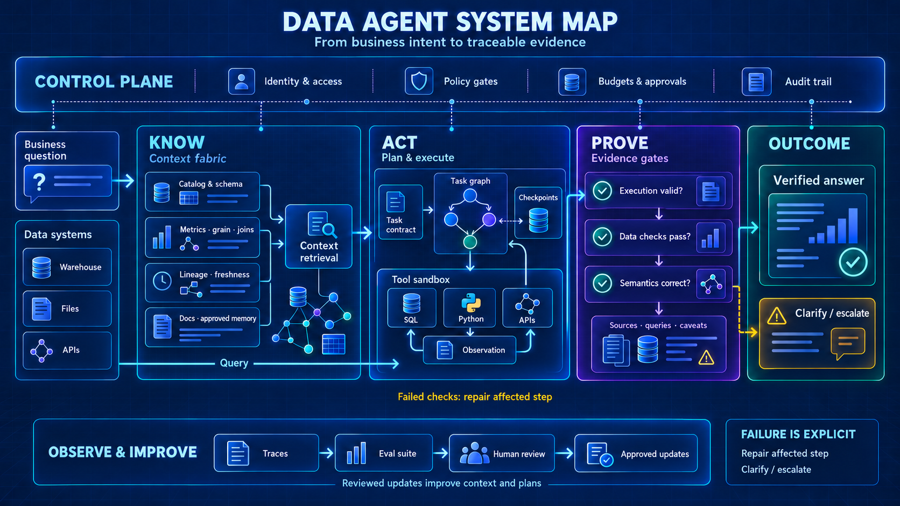

# Awesome Data Agents · 2026

> 一份把公开资料变成工程决策地图的 Data Agent 索引：从“能写 SQL”走向“可验证地完成数据工作”。



*原创工程参考图：上层治理贯穿全程；中部展开上下文、任务 DAG、工具沙箱与分层验证；下层单独呈现经人工审核的评测改进。点击图片可查看细节。*

<details>
<summary>如何读这张图：三条容易被忽略的工程边界</summary>

- **上下文不等于原始数据。** 目录、指标定义、粒度、关联关系和新鲜度帮助规划；实际查询与计算进入受控工具运行时，不要求把全部数据塞进模型。
- **执行成功不等于答案正确。** 执行、数据质量和业务语义分别校验，并保留来源、查询与限制。图中 Verified 表示通过所配置的检查并附有证据，不是正确性的绝对保证；证据不足应澄清、局部修复或升级处理。
- **评测改进不等于自动自我训练。** Traces → Eval suite → Human review → Approved updates 是经审核的改进链；失败修复只重跑受影响步骤，不默认重启整个流程，也不直接把未验证结论写入长期记忆。

</details>

**133 条资料** · `45` 架构与实践 · `31` 公开实现 · `18` 分享与议程 · `13` 研究 · `15` 持续文档 · `11` 评测  
**资料截止：2026-10-22（Asia/Shanghai）**

[先看结论](#先看结论) · [参考架构](#一眼看懂-data-agent) · [交付成熟度](#交付成熟度从会回答到可托付) · [反模式](#工程模式与反模式) · [10 个起点](#2026-十个起点) · [国际导航](#国际资料导航) · [工程实践](#工程实践与公开分享) · [中文分享](#中文与国内实践) · [公开实现](#开源实现与公开源码) · [项目路线](PROJECT_GUIDE.md) · [论文评测](#论文与评测) · [设计评审模板](DESIGN_REVIEW.md) · [机器索引](resources.json)

这里不追求链接数量。每条资料都尽量回到作者、项目或大会原始页面，并回答三个问题：**它解决什么、采用什么机制、证据边界在哪里。** 仓库进一步把分散材料提炼成参考架构、交付成熟度与设计检查表，帮助读者做方案判断，而不只是收藏链接。

<details>
<summary><strong>English summary</strong></summary>

A source-checked, 2026-focused field guide to Data Agent architectures, production write-ups, public implementations, benchmarks, papers, and talks. Beyond indexing links, it synthesizes an engineering model for context, execution, verification, and governance. Chinese annotations stay concise while original titles and first-party links are preserved.

</details>

## 先看结论

> 以下是本仓对 2026 年公开材料的编辑归纳，不是行业标准或厂商排名。判断依据均可沿链接回到原始资料。

1. **瓶颈正从“模型会不会写 SQL”转向“系统有没有正确上下文”。** Schema 只是起点，业务指标、术语、血缘、历史查询、组织知识与新鲜度共同决定答案上限。可对照 [OpenAI](https://openai.com/index/inside-our-in-house-data-agent/)、[Anthropic](https://claude.com/resources/articles/how-anthropic-enables-self-service-data-analytics-with-claude) 与 [Snowflake](https://www.snowflake.com/en/blog/agent-context-layer-trustworthy-data-agents/) 的实践。
2. **可靠性来自受限执行器与独立验证，而不是更长的推理文本。** SQL、Python 或 Spark 需要在可控环境执行；“能运行”“结果合理”“业务语义正确”必须分开检查。
3. **语义层正在从静态词典变成 Agent 循环中的 runtime 与 validator。** 它不仅解释指标，也约束 grain、join、fan-out、权限和工具选择。
4. **评测单位正在从最终答案扩展到轨迹、证据、拒答、成本与时延。** [Hex](https://hex.tech/blog/evaluate-data-agents/)、[DAB](https://arxiv.org/abs/2603.20576) 和 [ClickHouse](https://clickhouse.com/blog/agentic-analytics-benchmark-data-agent-mnist) 展示了不同层次的测法。
5. **Multi-Agent 不是默认答案。** 只有并行探索、专业分工或权限隔离带来明确收益时，额外的状态、成本和故障链路才值得承担；其余场景先把单 Agent、确定性工具与验证闭环做好。

## 一眼看懂 Data Agent

Data Agent 的难点，不只是把自然语言翻译成查询，而是让系统在正确的数据、业务语义和权限边界内，完成可执行、可验证、可追溯的分析。本仓用四个问题组织资料：**它知道什么、如何行动、怎样证明、由谁控制。**

| 工程轴 | 核心问题 | 关键构件 | 交付时应看到什么 |
|---|---|---|---|
| **Know · 上下文** | Agent 是否拿到了正确的业务语境？ | Schema、指标口径、Glossary、Lineage、历史查询、Ontology、Skills | 上下文有来源、版本、权限和新鲜度，而不是一次性把整库 Schema 塞进 Prompt |
| **Act · 执行** | Agent 如何把问题变成受控步骤？ | 澄清、计划、工具选择、SQL/Python/Spark、Sandbox、停止条件 | 每一步可中断、可复现；高风险工具受限，凭据不进入模型上下文 |
| **Prove · 验证** | 为什么相信结果，而不只是一段流畅回答？ | 语法、结果与语义检查，引用、轨迹、不确定性 | 展示数据来源、执行过程与验证结果；证据不足时拒答或升级 |
| **Control · 运营** | 上线后如何持续安全、稳定地工作？ | 权限、审批、审计、Trace、Evals、回归集、成本/时延预算、反馈与记忆 | 质量退化可发现，错误可追踪，写操作可审批，版本可回滚 |

```text
业务问题
   ↓
意图识别与澄清 ───────────── 身份、权限与风险策略
   ↓
上下文路由 ───── Schema｜指标｜术语｜血缘｜历史｜Skills
   ↓
计划与工具选择 ───────────── 任务分解、预算、停止条件
   ↓
受控执行 ─────── SQL｜Python｜Spark｜搜索｜BI
   ↓
多层验证 ─────── 可运行｜结果｜语义｜证据｜不确定性
   ↓
回答或经审批的行动
   ↺
Trace → Evals → 回归 → 反馈/记忆
```

只覆盖中间的“生成并运行 SQL”，仍是能力组件；上下文、执行、验证和运营形成闭环后，系统才接近可长期使用的 Data Agent。

## 交付成熟度：从会回答到可托付

这里衡量的不是模型聪明程度，而是一个 Data Agent 是否具备进入真实工作流的条件；它与论文中的自治等级不是同一套分类。

| 阶段 | 系统能做什么 | 升级前必须补齐 |
|---|---|---|
| **M0 · 可检索** | 找到相关表、指标和文档，回答定义类问题 | 权威来源、权限过滤、上下文新鲜度 |
| **M1 · 可执行** | 运行 SQL/代码，产出表格或图表 | 只读默认、Sandbox、超时/行数限制、可复现产物 |
| **M2 · 可验证** | 检查计划、查询、结果和业务语义，并附带证据 | 失败分类、确定性校验、引用、拒答与人工升级路径 |
| **M3 · 可运营** | 在生产环境持续服务，并发现质量回退 | Trace、版本化回归集、Baseline、成本/时延预算、发布门禁 |
| **M4 · 可行动** | 在明确授权后触发下游流程或写操作 | 人工审批、最小权限、幂等、回滚与完整审计 |

成熟度不是功能计数：若权限、验证或回滚缺位，即使系统能完成复杂任务，也不应向更高阶段标注。可直接使用 [Data Agent 设计评审模板](DESIGN_REVIEW.md) 做上线前检查。

## 按目标阅读

| 你的目标 | 建议先读 | 再看实现/评测 |
|---|---|---|
| 企业问数 / ChatBI | OpenAI、Anthropic、Snowflake Context Layer | DAB、Shopee、DataHub |
| 多源深度分析 | Google Data Agent Kit、Databricks Genie | DataSpace、DeepEye |
| 数据工程 Agent | Altimate Code、Snowflake Cortex Code | DataClawEval、DataWorks、RHOAI |
| 质量与评测体系 | OpenAI、Hex、ClickHouse | AgenticDataBench、Microsoft workshop |
| 语义与上下文层 | DataHub、EvoOntology、Datus | WrenAI、Snowflake Cortex Sense |

## 工程模式与反模式

| 反模式 | 典型症状 | 更稳妥的工程模式 |
|---|---|---|
| **Schema 全量灌入 Prompt** | 上下文过长、过时，命中原因难解释 | 分层检索，只装配与当前问题有关的 Schema、指标和历史证据 |
| **SQL 能跑就算正确** | Grain、Join、单位或业务口径仍可能错误 | 把执行校验、结果校验、语义校验与证据检查拆开 |
| **默认上 Multi-Agent** | 状态、成本和故障链路变复杂，却没有明确收益 | 先完成单 Agent 闭环；仅在并行、分工或隔离确有需要时拆分 |
| **模型直连全部数据与工具** | 权限过宽、凭据暴露、工具选择不可控 | 通过受治理工具层连接，采用最小权限、只读默认和 Sandbox |
| **只测演示样例** | Happy path 顺畅，遇到脏 Schema、歧义或缺失数据就失效 | 建立真实任务回归集、失败分类与 Candidate-vs-Baseline 评测 |
| **永久记忆但没有治理** | 旧口径与错误经验被持续复用 | 为记忆标注来源、版本、Owner 与失效策略 |
| **直接开放写操作** | 分析错误被放大为下游动作 | 写操作单独授权，并增加审批、幂等、审计与回滚 |

## 收录边界

这里的 **Data Agent** 指能在受治理的数据环境中，自主完成部分或全部数据发现、语义理解、查询/代码生成、执行、验证、分析、可视化、报告或后续行动的智能体系统。它不等同于只有一次 Text-to-SQL 调用的聊天框。

- 优先一手来源；必须能核验到 2026 年日期或重要更新，并包含可复用的架构、实现或评测信息。
- 厂商内部数字只按“发布方自述”记录，不做跨系统排名；无项目级许可证的仓库只称“公开源码”。
- `🧪` 为研究或早期项目；`♻️` 为旧项目的 2026 重要更新；`📅` 为截止日仅有议程，不能视作已有回放；`🗄️` 为已归档实现。

完整规则见 [METHODOLOGY.md](METHODOLOGY.md)，结构化元数据见 [resources.json](resources.json)。

## 2026 十个起点

1. **2026-01-29 · [Inside OpenAI’s in-house data agent](https://openai.com/index/inside-our-in-house-data-agent/)** — 表使用、人工标注、Codex 代码富化、组织知识、记忆和运行时上下文六层 grounding；同时公开了 SQL/结果联合评测思路。
2. **2026-06-03 · [How Anthropic enables self-service data analytics with Claude](https://claude.com/resources/articles/how-anthropic-enables-self-service-data-analytics-with-claude)** — 把可信数据基础、source of truth、Skills、验证与同代码评审流程连接起来。
3. **2026-05-19 · [Data Agent Kit brings data skills and tools to your IDE or CLI](https://cloud.google.com/blog/products/data-analytics/data-agent-kit-brings-data-skills-and-tools-to-your-ide-or-cli/)** — “通用 Coding Agent + Data Skills + MCP tools”路线的代表。
4. **2026-05-08 · [Pushing the Frontier for Data Agents with Genie](https://www.databricks.com/blog/pushing-frontier-data-agents-genie)** — 专项知识搜索、并行思考、多模型和自纠错/验证的组合设计。
5. **2026-03-19 · [The Agent Context Layer for Trustworthy Data Agents](https://www.snowflake.com/en/blog/agent-context-layer-trustworthy-data-agents/)** — 从语义、规则、权限和验证解释可信 Data Agent 的上下文层。
6. **2026-04-16–18 · [Shopee：从 AI 取数到智能分析](https://qcon.infoq.cn/2026/beijing/presentation/7006)** — 从单链 RAG 到渐进披露 Multi-Agent、File-as-Context、Sandbox、Skills 与评测运营闭环。
7. **2026-02-04 · [Data Agents: Levels, State of the Art, and Open Problems](https://arxiv.org/abs/2602.04261)** — 从 L0 到 L5 的自治分级，是建立共同语言的最佳入口之一。
8. **2026-03-21 · [Can AI Agents Answer Your Data Questions?](https://arxiv.org/abs/2603.20576)** — 面向真实企业异构数据库任务的 DAB benchmark；建议同时查看最新版论文与榜单。
9. **2026-08-04 · [DataSpace](https://arxiv.org/abs/2608.03451)** — 410 个跨语言任务、六种模态与确定性表格评测，也是 KDD Cup 2026 Data Agent Track 的官方 benchmark。
10. **2026-09-15 · [EvoOntology](https://github.com/ruc-datalab/EvoOntology)** — 通过 MCP 暴露可版本化、可自演进的 Ontology Layer，直接回应语义层维护成本问题。

## 国际资料导航

从一个具体工程问题进入，再顺着实现、教程和评测阅读。下表是资料入口，不是厂商排名；完整项目路线见 [PROJECT_GUIDE.md](PROJECT_GUIDE.md)。

| 你想研究什么 | 建议入口 | 可复用的内容 |
|---|---|---|
| 数据工程 Agent 如何自行校验 | [dbt Wizard harness](https://docs.getdbt.com/blog/wizard-agent-harness) · [dbt Skills](https://docs.getdbt.com/blog/dbt-agent-skills) | DAG 上下文、编译反馈、限定验证范围、数据差异评审 |
| 分析 Agent 的工具如何设计 | [Cube Harness](https://cube.dev/blog/building-an-agentic-analytics-harness) · [Preset 生产化](https://preset.io/blog/preset-chatbot-technical-deep-dive/) | 结构化错误、结果分页、持久状态、异步与流式接入 |
| 上下文如何持续修正 | [Hex Context Suggestions](https://hex.tech/blog/introducing-context-suggestions/) · [MotherDuck Guides](https://motherduck.com/blog/context-belongs-in-the-warehouse/) | 会话复盘、人工审核、仓内上下文和版本管理 |
| BI 与多租户工具如何接入 | [Superset MCP](https://preset.io/blog/superset-mcp-service-deep-dive/) · [Preset 企业化](https://preset.io/blog/preset-mcp-open-source-to-enterprise/) | 预览与持久化分开、RBAC/RLS、工作区隔离 |
| 如何评测上下文和 Skills 的实际收益 | [Xorq 配对实验](https://xorq.dev/blog/orientation-over-reasoning/) · [Preset Skills 评测](https://preset.io/blog/building-preset-agent-skills/) | 固定条件对照、轨迹规则检查、质量与额外 token 成本 |
| 如何构建真实的数据工作验收集 | [ADE-bench](https://www.getdbt.com/blog/ade-bench-dbt-data-benchmarking) · [Hex DataBench](https://hex.tech/blog/databench-agentic-analytics-benchmark/) | 工程修复与开放分析采用不同验收；后者任务集仍私有 |
| 云平台上的 Agent 怎样继承真实用户权限 | [AWS 身份传播](https://aws.amazon.com/blogs/security/identity-aware-ai-data-agents-with-aws-lake-formation-and-trusted-identity-propagation/) · [Genie MCP](https://docs.databricks.com/aws/en/agents/mcp-tools/genie-mcp) | 身份沿工具链传递、按数据目录授权、记录访问证据 |

日期中的“更新”表示该页或项目在 2026 年的重要变更，不表示首次发布。资料数量按独立条目统计，同一项目的文章、实现与教程可能分别计数。

## 工程实践与公开分享

### 上下文、语义与可信分析

- **2026-01-22 · AWS · [Accelerate context-aware data analysis and ML workflows with Amazon SageMaker Data Agent](https://aws.amazon.com/blogs/big-data/accelerate-context-aware-data-analysis-and-ml-workflows-with-amazon-sagemaker-data-agent/)** — Glue/DataZone 目录、Notebook 状态、分析计划、Serverless 执行和 IAM 治理的端到端示例。
- **2026-01-28 · Hex · [Introducing Context Studio](https://hex.tech/blog/introducing-context-studio/)** — 统一管理数据资产认证、确定性指标模型和业务指南；从真实对话诊断错误，预览上下文修改，再版本化发布。
- **2026-01-29 · OpenAI · [Inside OpenAI’s in-house data agent](https://openai.com/index/inside-our-in-house-data-agent/)** — 六层上下文、按需 RAG、工具循环、可复用 workflow 与持续评测。
- **2026-03-06 · Pinterest Engineering · [Unified Context-Intent Embeddings for Scalable Text-to-SQL](https://medium.com/pinterest-engineering/unified-context-intent-embeddings-for-scalable-text-to-sql-793635e60aac)** — 用历史分析 SQL 的 context-intent embedding、结构/统计模式和治理信号先定位可信资产，再生成 SQL。
- **2026-03-19 · Snowflake · [The Agent Context Layer for Trustworthy Data Agents](https://www.snowflake.com/en/blog/agent-context-layer-trustworthy-data-agents/)** — 以业务定义、规则、时效与权限构建 Agent Context Layer。
- **2026-03-30 · Analytics at Meta · [Inside Meta’s Home Grown AI Analytics Agent](https://medium.com/@AnalyticsAtMeta/inside-metas-home-grown-ai-analytics-agent-4ea6779acfb3)** — 个人历史、域摘要、共享离线记忆与 Cookbook → Recipe → Ingredient 分层知识。
- **2026-04-23 · Hex · [Introducing Context Suggestions](https://hex.tech/blog/introducing-context-suggestions/)** — Review Agent 复盘代码、工具调用和分析输出，将澄清、歧义与缺失定义聚类成问题，并提出上下文变更供团队审核。
- **2026-04-30 · DataHub · [Introducing the DataHub Analytics Agent](https://datahub.com/blog/datahub-analytics-agent/)** — Context Graph 读写，联合 schema、glossary、lineage、owner、quality 与 freshness，并通过 MCP/Agent Context Kit 暴露。
- **2026-06-03 · Anthropic · [How Anthropic enables self-service data analytics with Claude](https://claude.com/resources/articles/how-anthropic-enables-self-service-data-analytics-with-claude)** — Skills 与 dbt/model 同 PR 更新，并用内部 eval 验证变更。
- **2026-06-30 · Snowflake · [Introducing Cortex Sense](https://www.snowflake.com/en/blog/enterprise-ai-agents-grounded-context/)** — 从查询历史、转换和 BI 指标提取上下文，并按权威性、流行度与新鲜度排序。
- **2026-07-10 · Cube · [The Context Layer Needs a Semantic Layer](https://cube.dev/blog/the-context-layer-needs-a-semantic-layer)** — 区分可执行语义、描述性业务知识与历史记忆，说明指标和权限如何在查询编译时落实；属于厂商架构观点。
- **2026-07-27 · LangChain · [How we built LangChain’s agent-first data stack](https://www.langchain.com/blog/agent-data-stack)** — dbt 模型、语义层和 Git 同步指南组成多层 context，并说明组织落地方式。
- **2026-07-29 · MotherDuck · [Context belongs in the warehouse](https://motherduck.com/blog/context-belongs-in-the-warehouse/)** — 将指标定义、关联规则和业务陷阱存为仓内 Markdown Guides，以 SQL 管理与版本化；Agent 经 MCP 按需读取，组织和个人上下文分层分发。
- **2026-08-17 · Snowflake · [Building an Internal Context Layer for AI Agents](https://www.snowflake.com/en/blog/snowflake-internal-context-layer-for-ai-agents/)** — 产品数据科学团队如何用内部语义层回答跨团队产品问题。
- **2026-09-16 · dbt Labs · [dbt_context_engineering: modeling the context your AI agents read](https://docs.getdbt.com/blog/dbt-context-engineering)** — 将工单、通话和合同等非结构化材料建模为 Agent 可检索、可引用的上下文，沿用版本、测试与血缘管理。
- **2026-09-29 · Datus · [The Semantic Layer in the Agent Loop](https://datus.ai/blog/semantic-layer-in-the-agent-loop/)** — 把语义层放进推理循环，作为 grain、fan-out、歧义与指标定义的确定性检查器。

### 编排、执行与数据工程

- **2026-02-03 · Snowflake · [Take Ideas to Production Faster with an Agentic AI Developer Platform](https://www.snowflake.com/en/blog/agentic-ai-developer-platform/)** — 用 catalog、lineage、RBAC、Skills 与受治理执行覆盖工程、分析和 ML。
- **2026-02-05 · dbt Labs · [Make your AI better at data work with dbt's agent skills](https://docs.getdbt.com/blog/dbt-agent-skills)** — 把建模、测试、语义层和迁移流程封装为按任务加载的 Skills；附接入与端到端工作流示例。
- **2026-03-12 更新 · Snowflake Developers · [Build a Cortex Agent from Scratch with Snowflake](https://www.snowflake.com/en/developers/guides/build-a-cortex-agent-from-scratch-with-snowflake/)** — 从样例数据、语义视图和 Cortex Search 建到双工具 Agent，再用 SQL/Python 测试，复现指标与产品文档的统一问答。
- **2026-03-27 · ClickHouse · [How we’re building a data platform for a new user: agents](https://clickhouse.com/blog/building-a-data-platform-for-agents)** — 以 LibreChat、ClickHouse＋MCP 和 Langfuse 构成交互、数据及观测三层架构，讨论探索型查询、上下文发现和任务级权限。 **文中含路线图，需区分已发布与计划能力。**
- **2026-04-11 · Google Cloud · [Building Event-Driven Data Agents with BigQuery, Pub/Sub, and ADK](https://cloud.google.com/blog/topics/developers-practitioners/building-event-driven-data-agents-with-bigquery-pubsub-and-adk)** — Detection → Routing → Resolution → Observability 的事件驱动闭环，并保留人工升级。
- **2026-04-17 · Databricks · [Introducing Genie Agent Mode](https://www.databricks.com/blog/introducing-genie-agent-mode)** — 从问答模式扩展到多步探索、假设验证和结构化解释。
- **2026-04-21 · Snowflake · [Cortex Code Expands: One Governed Agent for Your Entire Data Stack](https://www.snowflake.com/en/blog/cortex-code-governed-agent-data-stack/)** — Skills、SDK、MCP、ACP、Sandbox 与 Plan Mode 的平台化组合。
- **2026-04-30 · AWS · [Agentic analytics with SageMaker, Athena, and Amazon Quick](https://aws.amazon.com/blogs/machine-learning/unleashing-agentic-ai-analytics-on-amazon-sagemaker-with-amazon-athena-and-amazon-quick/)** — 把结构化查询、非结构化知识库与受治理的自助分析组合起来。
- **2026-05-05 · Preset · [Shipping Preset Chatbot: From AI Prototype to Production](https://preset.io/blog/preset-chatbot-technical-deep-dive/)** — MCP 统一多端能力，LangGraph 持久化对话；详述异步 Agent 接入同步 Web 框架、独立连接池、SSE 桥接和工具错误处理。
- **2026-05-08 · Databricks · [Pushing the Frontier for Data Agents with Genie](https://www.databricks.com/blog/pushing-frontier-data-agents-genie)** — 结构化与非结构化数据的并行发现、自纠错和验证。
- **2026-05-19 · Google Cloud · [Data Agent Kit brings data skills and tools to your IDE or CLI](https://cloud.google.com/blog/products/data-analytics/data-agent-kit-brings-data-skills-and-tools-to-your-ide-or-cli/)** — 预置 Skills + MCP tools，把 BigQuery、AlloyDB、GCS 等带进常用 Agent。
- **2026-06-02 · Cube · [Introducing Cube Agent Skills](https://cube.dev/blog/introducing-cube-agent-skills)** — 把周报、流失分析和模型变更流程存为模型项目中的 Markdown Skills，经分支、评审与部署复用。
- **2026-06-09 · ClickHouse · [ClickHouse Agents: Claude-powered agentic analytics, now in public beta](https://clickhouse.com/blog/clickhouse-agents-beta)** — 将原生查询、MCP、沙箱代码执行、Skills、记忆、子 Agent 与分析产物整合到 Cloud RBAC 下的 LibreChat 托管运行时。 **公开 Beta。**
- **2026-06-15 · Google Cloud · [What’s new in data agents](https://cloud.google.com/blog/products/data-analytics/new-data-agents-across-the-agentic-data-cloud/)** — 分析、数据科学、数据工程和数据库可观测 Agent 的产品矩阵。
- **2026-07-23 · Databricks · [Why a Frontier Data Agent Outperforms General Coding Agents](https://www.databricks.com/blog/why-frontier-data-agent-outperforms-general-coding-agents-quality-and-cost)** — 用真实内部任务讨论专项检索、持久记忆和企业上下文的价值；对比结果属于厂商内部评测。
- **2026-09-03 · Cube · [Building an Agentic Analytics Harness](https://cube.dev/blog/building-an-agentic-analytics-harness)** — 从 Semantic SQL、可恢复工具错误、结果截断提示、持久产物和权限过滤检索拆解分析 Agent 的运行机制。
- **2026-09-08 · Google Cloud · [Agentic analytics with the Data Agent Kit](https://cloud.google.com/blog/products/data-analytics/agentic-analytics-with-the-data-agent-kit)** — BigQuery、Cloud SQL 与 GCS 多源根因分析教程，包含权限确认和执行轨迹。
- **2026-09-10 · OpenAI · [Now everyone can put data to work](https://openai.com/index/put-data-to-work/)** — Data agent 从分析延伸到交互式仪表盘与经批准的后续行动；适合观察产品化边界。
- **2026-09-24 · DevConf.US · [Building In-House Data Agents on RHOAI](https://pretalx.devconf.info/devconf-us-2026/talk/P9W73V/)** — OpenShift AI、Spark、Kubeflow Operator、Context Layer 与 MCP tools 的管道诊断/修复案例。
- **2026-09-30 · Google Cloud · [Data Agent Kit is now GA](https://cloud.google.com/blog/topics/developers-practitioners/data-agent-kit-is-now-ga-bring-google-data-cloud-to-any-coding-agent)** — 免费 MCP tools + Agent Skills 的 GA 发布和兼容 Agent 说明。
- **2026-10-09 更新 · Snowflake Developers · [Getting Started with the Cortex Agent SDK](https://www.snowflake.com/en/developers/guides/getting-started-with-cortex-agent-sdk/)** — 五个递进示例覆盖流式结果、多轮会话、后台运行与代码沙箱，最终组成检查流水线、数据质量并按需诊断事故的运维 Agent。
- **2026-10-14 · dbt Labs · [Inside the dbt Wizard harness: building an agent that thinks in DAGs](https://docs.getdbt.com/blog/wizard-agent-harness)** — 拆解 DAG 上下文、编译反馈、专用验证 Agent、批准范围内构建与 deferral；将数据差异交给人工评审。
- **2026-10-16 · Google Cloud · [Cross-cloud agentic analytics reference architecture](https://docs.cloud.google.com/architecture/agentic-ai-cross-cloud-analytics)** — 面向多云数据湖、仓库和非结构化数据的高层参考架构。

### 身份、权限与接入治理

- **2026-03-31 · Preset · [Preset MCP: From Open Source to Enterprise](https://preset.io/blog/preset-mcp-open-source-to-enterprise/)** — 通过外围中间件为 MCP 服务加入工作区隔离、逐请求数据库绑定、OAuth、弹性部署及可观测性，同时复用原有权限检查。
- **2026-03-31 · Preset / Apache Superset · [Apache Superset MCP Service: A Technical Deep Dive](https://preset.io/blog/superset-mcp-service-deep-dive/)** — MCP 直接复用 Superset Python 库与 DAO；图表修改默认预览，持久化显式执行；沿用 RBAC/RLS 并限制响应 token。
- **2026-10-06 · AWS Security Blog · [Identity-aware AI data agents with AWS Lake Formation and Trusted Identity Propagation](https://aws.amazon.com/blogs/security/identity-aware-ai-data-agents-with-aws-lake-formation-and-trusted-identity-propagation/)** — 贯穿 AgentCore、MCP Gateway、Lambda 和 Athena 传递真实用户身份，由 Lake Formation 授权并用 CloudTrail 核验。

### 评测、质量与可观测性

- **2026-02-17 · Amplitude · [Can agents take on enterprise analytics? A task-based evaluation](https://amplitude.com/blog/ai-analytics-agents-task-based-evaluation)** — 用描述、诊断、预测、处方四类任务与透明度/证据 rubric 取代单一 Text-to-SQL 分数。
- **2026-04-22 · Xorq · [Orientation Over Reasoning](https://xorq.dev/blog/orientation-over-reasoning/)** — 固定模型、执行预算与评分器，在 450 个 DABStep 问题上比较原始文件与 33 个命名语义表达式目录，公开环境、日志及评分流程。 **作者明确提示公开题污染，配对成绩不作排行榜依据。**
- **2026-04-30 · Dot · [From 10% to 90% on Adyen’s DABstep: configuring a data warehouse agent](https://www.getdot.ai/blog/from-10-to-90-percent-on-adyens-dabstep)** — 将业务约定与重复分析路径沉淀为配置，再让 Agent 读取失败、提出修改并重新测量；用版本化实验记录保留成功和回退路径。 **仅覆盖 30 个任务、14 个配置版本；标题中的 90% 不是全量基准得分。**
- **2026-05-22 · Hex · [How we built a lab to evaluate data agents](https://hex.tech/blog/evaluate-data-agents/)** — candidate-vs-baseline、确定性/LLM/混合评分和带脏 schema 的合成公司数据。
- **2026-06-11 · Preset · [Preset Agent Skills: Giving Your AI Agent Real Preset Expertise](https://preset.io/blog/building-preset-agent-skills/)** — 以 31 个真实 BI 操作任务成对比较有无 Skills，重复运行并确定性检查工具选择、执行顺序、审批节点与秘密保护。 **结果限于作者任务集，并增加上下文成本。**
- **2026-08-04 · Hex · [Introducing Evals](https://hex.tech/blog/evals/)** — 版本化 YAML eval suite、Context Preview、定时漂移检测和模型/成本 sweep。
- **2026-08-13 · Hex · [Introducing DataBench](https://hex.tech/blog/databench-agentic-analytics-benchmark/)** — 在混乱的合成企业数据仓库中设置 100 个问答与开放分析任务，覆盖指标歧义、缺失证据和拒绝作答。 **任务集保持私有，适合研究评测方法。**
- **2026-09-01 · ClickHouse · [The Agentic Analytics Benchmark](https://clickhouse.com/blog/agentic-analytics-benchmark-data-agent-mnist)** — 201 个生产问题、29 个模型，以通过率、成本、时延和轮次预算联合评测；公开方法和限制。
- **2026-09-17 更新 · Databricks Documentation · [Test and monitor a Genie Agent](https://docs.databricks.com/aws/en/genie-agents/monitor)** — 串联线上反馈、人工纠错与离线基准；区分 Chat 的 SQL 结果比较和 Agent 的 LLM 评判，适合设计持续维护的验收集。
- **2026-10-14 更新 · dbt Labs · [Introducing ADE-bench: measuring how AI agents perform data work](https://www.getdbt.com/blog/ade-bench-dbt-data-benchmarking)** — 以真实 dbt 项目、DuckDB 数据与 Docker 环境测试模糊修复任务，并联合观察测试通过率、成本和运行时。 **结果属于发布方特定配置。**

### 演讲与视频

- **2026-05-21 · Preset · [Anatomy of our Internal Data Agent](https://preset.io/events/how-we-built-our-agents/)** — 公开 Live Talk，覆盖内部数据专家、工具、语义层和数据团队工作方式。
- **2026-05-26 · Open Data Circle · [Data Agents Need an Agent-facing Data Plane](https://speakerdeck.com/opendatacircle/data-agents-need-an-agent-facing-data-plane)** — freshness、semantics、multimodality、governance、actionability、observability 六维框架与演进图。

## 中文与国内实践

### 已公开材料

- **2026-08-17 · 中国互联网协会人工智能工作委员会 × 中国信通院 · [《数据智能体研究报告（2026）》征求意见稿](https://www.isc.org.cn/article/30075177847877632.html)** — 55 页中文分类框架，覆盖定义、与 BI/RPA/NL2SQL/LLM 的差异、参考架构、关键技术、生态、应用和安全合规；注意它是征求意见稿，不是最终版。
- **2026-04-17 / 2026-07-14 · Shopee @ QCon 北京 · [议题页](https://qcon.infoq.cn/2026/beijing/presentation/7006) / [全文实录](https://www.infoq.cn/article/LfO7mzdhxMWTtICFuTNb)** — 渐进披露 Multi-Agent、画像/记忆、语义模型、File-as-Context、Sandbox、Skills 和自动评测；目前未核到官方完整视频。
- **2026-04-16–18 · 网易 @ QCon 北京 · [从 Copilot 到 DataAgent：企业级智能数据开发治理平台的技术演进和实践](https://qcon.infoq.cn/2026/beijing/presentation/7030)** — EasyData 从 Copilot、Agent 到 CLI 化，并连接任务诊断与智能分析。
- **2026-04-16–18 · 美团 @ QCon 北京 · [不止 ChatBI：懂归因、能洞察的美团 Data Agent 落地实践](https://qcon.infoq.cn/2026/beijing/presentation/6946)** — 全流程架构、业务知识图谱、记忆、动态语义层和机评体系。
- **2026-04-25 · 同程旅行 @ DACon 上海 · [DataAgent 在分析和营销场景的智能化建设探索](https://www.bagevent.com/event/9108668/p/569570)** — 从分析规划、归因到营销建议与流程的闭环；页面为大会摘要。
- **2026-07-03 · 腾讯云大数据 · [构建可信、可控、可演进的 Data Agent](https://developer.cloud.tencent.cn/article/2703714)** — 统一语义层、多 Agent、Skills、权限审计和持续学习六要素。
- **2026-08-21–22 · 数新智能 @ AICon 深圳 · [基于 DataCyber 的 Data Agent](https://aicon.infoq.cn/2026/shenzhen/presentation/7205)** — SRW 执行三角与 GPME 治理四件套，连接湖仓、元数据、语义层和 MCP 工具面。
- **2026-09-01 · 腾讯 DataBuddy · [数据语义驱动的企业 Agent Runtime 实践](https://developer.cloud.tencent.cn/article/2735067)** — Runtime、权限、沙箱、HITL、Trace、分层记忆与评测回流三条主线。
- **2026-09-09 · 云器科技 · [从 Tool Calling 到 Data Agent：企业数据智能体的生产化路径](https://www.yunqi.tech/resource/blogs/enterprise-data-agent-production)** — 语义层、长工作流、Sandbox、Trace 与评测闭环；效果数字属于厂商案例口径。
- **2026-09-10 · 腾讯云大数据 · [2026 腾讯云大数据年度精选技术实践指南](https://www.infoq.cn/minibook/W2lxNULd8rJGsXWjEgMX)** — 汇总 DataBuddy、WeData、Agent-Ready 数据平台与 ChatBI → 决策智能体实践。
- **2026-09-19 · 快手技术沙龙 · [Data Agent：数据生产与智能决策新范式](https://www.ithome.com/1/005/819.htm)** — 父子 Agent、Skills、知识/记忆、Trace 与评测准入；当前可得页面是媒体回顾，数字应视为“据快手分享”。

### 观察名单：截止日后议程

<details>
<summary><strong>展开 2026-10-22 截止时尚未发生的 Data Agent 场次</strong></summary>

QCon 上海大会时间为 **2026-10-22–24**，但以下 Data Agent 场次均排在 **10 月 23 日**。因此链接只是官方议题大纲，不能写成已有演讲成果、录像或 PPT：

- [专题总页：Agentic 时代的数据系统重构](https://qcon.infoq.cn/2026/shanghai/track/1976)
- [网易云音乐 DAS：AI 原生一站式数据开发治理平台](https://qcon.infoq.cn/2026/shanghai/presentation/7257) — 五层 AI Infra、安全纵深、数据虚拟化与语义知识库。
- [快手：Data Agent 数据生产与智能决策新范式](https://qcon.infoq.cn/2026/shanghai/presentation/7230) — 父子 Agent、动态上下文管理、知识飞轮与自动评测。
- [Datus：Semantic Runtime](https://qcon.infoq.cn/2026/shanghai/presentation/7342) — 语义模型到 SQL 编译、grain/cardinality/fan-out 与 Ontology tools。
- [小红书 DIBP](https://qcon.infoq.cn/2026/shanghai/presentation/7343) — 单 Agent → Harness → Multi-Agent 与 Context Layer。
- [美团 AIDE 数据研发 Agent](https://qcon.infoq.cn/2026/shanghai/presentation/7356) — 需求、开发测试、审批上线、高风险护栏与真实会话评测。
- [DACon 北京 2026 议程](https://www.bagevent.com/event/9196611) — 10 月 23–24 日包含 360、高德、京东、理想汽车和 OntoOS 等 Data Agent/本体相关场次；截至截止日同样属于 upcoming agenda。

</details>

## 开源实现与公开源码

> “公开源码”不自动等于 OSI 开源。下列无许可证、混合许可证或 EAP 项目已显式标注；使用前请自行核对仓库当前 LICENSE。

### 选型快表

这张表只做入口导航，不是排行榜。完整说明和许可证提示仍以下方项目条目为准。

| 采用目标 | 可先看 | 值得关注 | 采用前检查 |
|---|---|---|---|
| 给现有 Coding Agent 增加数据能力 | Google Data Agent Kit Plugin | Skills 与 MCP tools 的组合 | 支持的数据源、客户端兼容性与权限范围 |
| 用元数据图谱支撑可信分析 | DataHub Analytics Agent | Context Graph 读写与知识反馈 | 元数据完整度、Warehouse 连接和写回边界 |
| 做 dbt / SQL 工程 Agent | Altimate Code | 确定性工具、编译与校验 | 项目兼容性、执行隔离和人工 Review 门禁 |
| 做企业多源分析 | DataFoundry | 统一语义、只读边界与审计回放 | 项目仍处早期，需验证连接器和运维能力 |
| 编排复杂分析计划 | DeepEye | Typed DAG、Validator、Optimizer、Executor | 研究实现与生产治理之间的补齐成本 |
| 建设可演进语义层 | EvoOntology | 版本化 Ontology 与 MCP 暴露 | 本体维护责任、变更审核和回滚机制 |
| Java / Spring 技术栈 | Spring AI Alibaba DataAgent | Graph 编排、SQL/Python 分析、MCP/RAG | 与现有权限、数据源和观测体系的集成 |
| 语义建模驱动问数 | WrenAI | 开放上下文层与语义模型 | 多许可证边界、部署模式和治理需求 |

### 2026 新项目 / 新公开实现

- **GoogleCloudPlatform/[data-agent-kit-plugin](https://github.com/GoogleCloudPlatform/data-agent-kit-plugin)** — 15+ Google Data Cloud 服务的 MCP tools + Agent Skills；面向 Codex、Claude Code 等插件客户端。Apache-2.0。
- **datahub-project/[analytics-agent](https://github.com/datahub-project/analytics-agent)** — DataHub Context Graph/MCP → SQL warehouse → LangGraph/LLM → Vega-Lite，并能把缺失术语和文档反馈给上下文图。Apache-2.0。
- **AltimateAI/[altimate-code](https://github.com/AltimateAI/altimate-code)** — dbt/SQL/数据工程 Agent harness，强调大量确定性工具和编译引擎校验。MIT。
- **datagallery-ai/[dataagent](https://github.com/datagallery-ai/dataagent)**（DataFoundry）— 28 类数据源、统一语义、只读边界、凭据隔离、字段脱敏与全链路回放。Apache-2.0；项目自标 early but usable。
- **aliyun/[data-agent-skill](https://github.com/aliyun/data-agent-skill)** — 阿里云 Data Agent 的 CLI 与 MCP 两套 Skills，支持数据库/文件分析、深度报告与会话复用；仓库当前未声明项目级许可证时应按公开源码处理。
- **aws-samples/[sample-data-agent-on-duckdb](https://github.com/aws-samples/sample-data-agent-on-duckdb)** — AgentCore 内进程 DuckDB，直接查询 S3 Parquet、S3 Tables、Glue Catalog 与 DuckLake。MIT-0。
- **microsoft/[fabric-data-agent-workshop](https://github.com/microsoft/fabric-data-agent-workshop)** — 语义模型准备、多源 Agent、LLM-as-Judge 校准与 MLflow 评测的动手 workshop。MIT。
- **HKUSTDial/[DeepEye](https://github.com/HKUSTDial/DeepEye)** — 自然语言计划编译为 typed DAG，再经 Validator → Optimizer → Executor；区分 AgentNode 与确定性 ToolNode，支持并行、Sandbox 和人工 steering。Apache-2.0。
- **openai/[openai-cookbook Data Analyst](https://github.com/openai/openai-cookbook/tree/main/examples/agents_api/apps/data_analyst)** — `search_tables`、`search_context`、`query_warehouse`、`save_memory` 四个聚焦工具；凭据不进模型，数据库连接只读并限制超时/行数。
- **ruc-datalab/[EvoOntology](https://github.com/ruc-datalab/EvoOntology)** — 面向异构表/文件/数据库的自演进 Ontology Layer，提供 MCP、Codex 和 Claude Code 插件。MIT。
- **HKUSTDial/[DataSpace](https://github.com/HKUSTDial/DataSpace)** — 异构工作区 benchmark、数据集、evaluator 和 baseline；KDD Cup 2026 官方 benchmark。MIT。
- **AgenticDataBench/[AgenticDataBench](https://github.com/AgenticDataBench/AgenticDataBench)** — 15 个领域、细粒度技能标签、生成器、testbed 和多 Agent harness。Apache-2.0。
- **HKUSTDial/[kddcup2026-data-agents-starter-kit](https://github.com/HKUSTDial/kddcup2026-data-agents-starter-kit)** — 最小 ReAct baseline 与竞赛输入/输出协议。**无项目级 LICENSE，按公开源码处理。**
- **Automattic/[agentic-analytics](https://github.com/Automattic/agentic-analytics)** — 面向 Parse.ly、GA 与第一方数据的 Coding Agent plugin，使用 DuckDB 本地缓存并生成报告。早期、**无 LICENSE**。

### ♻️ 2026 重要更新 / 持续活跃

- **spring-ai-alibaba/[DataAgent](https://github.com/spring-ai-alibaba/DataAgent)** — Spring AI Alibaba Graph 上的企业数据分析 Agent，覆盖 Text-to-SQL、Python 深度分析、报告、MCP 与 RAG。Apache-2.0。
- **getnao/[nao](https://github.com/getnao/nao)** — context-as-code、版本化评测、自托管 UI 与 MCP；2026-02 公开发布。**Open-core / mixed license**。
- **JetBrains/[databao-agent](https://github.com/JetBrains/databao-agent)** — Context engine/语义层驱动的本地 Python Data Agent，连接 SQL、dbt 与 Vega-Lite。**EAP，不建议生产使用。**
- **Canner/[WrenAI](https://github.com/Canner/WrenAI)** — 开放上下文层/语义模型驱动的 governed text-to-SQL 和图表；2026-10 有重要版本。**多许可证，按子目录核对。**
- **eosphoros-ai/[DB-GPT](https://github.com/eosphoros-ai/DB-GPT)** — 通用 Agentic AI 数据助手/应用平台；2026-08 发布 v0.8.2。MIT。
- **ucbepic/[DataAgentBench](https://github.com/ucbepic/DataAgentBench)** — 企业异构 DB benchmark、验证器与持续榜单。**根目录无 LICENSE，按公开 benchmark 处理。**

### 更多项目与工程组件

按实现类型区分完整 Agent、工作区、工具服务、语义组件和评测环境。每项的机制、技术文档、2026 更新证据与使用边界见 [项目资料路线](PROJECT_GUIDE.md)。

| 项目 | 类型 | 核心机制 / 用途 | 许可证与状态 |
|---|---|---|---|
| [Datus Agent](https://github.com/Datus-ai/Datus-agent) | 完整 Agent | 以可演进上下文引擎连接 SQL、指标和知识；v0.4.3 增加 SQL 血缘初始化与有来源的事实沉淀。 | [Apache-2.0](https://github.com/Datus-ai/Datus-agent/blob/main/LICENSE)；2026 有重要更新 |
| [dbt MCP Server](https://github.com/dbt-labs/dbt-mcp) | 工具服务 | 把 dbt 项目、指标、血缘与执行工具暴露给 Agent；适合把“读上下文—改模型—编译测试”接入同一工作流。 | [Apache-2.0](https://github.com/dbt-labs/dbt-mcp/blob/main/LICENSE)；2026 有重要更新 |
| [dbt Agent Skills](https://github.com/dbt-labs/dbt-agent-skills) | 技能包 | 可安装的 dbt 流程知识：先检查真实数据、迭代建模、再测试验证；包含指标建模与技能 A/B 评估材料。 | [Apache-2.0](https://github.com/dbt-labs/dbt-agent-skills/blob/main/LICENSE)；2026 有重要更新 |
| [ADE-bench](https://github.com/dbt-labs/ade-bench) | 评测环境 | 用真实 dbt 项目、数据库、隔离容器与结果测试评测数据工作；可比较模型、MCP、技能包带来的效果与成本。 | [Apache-2.0](https://github.com/dbt-labs/ade-bench/blob/main/LICENSE)；2026 有重要更新 |
| [MCP Toolbox for Databases](https://github.com/googleapis/mcp-toolbox) | 工具服务 | 用预置数据库工具或参数化查询为 Agent 接入数据；集中处理连接池、认证与 OpenTelemetry，适合执行层复用。 | [Apache-2.0](https://github.com/googleapis/mcp-toolbox/blob/main/LICENSE)；2026 有重要更新 |
| [Boring Semantic Layer (BSL)](https://github.com/boringdata/boring-semantic-layer) | 语义组件 | 基于 Ibis 的轻量语义层，将维度与指标封装为可查询模型；可作为 Agent 的指标工具底座，减少临时重写口径。 | [MIT](https://github.com/boringdata/boring-semantic-layer/blob/main/LICENSE)；2026 有重要更新 |
| [R&D-Agent](https://github.com/microsoft/RD-Agent) | 实验 Agent | 以研究 Agent 提出假设、开发 Agent 编码实验、执行反馈再迭代，覆盖数据科学与建模任务，适合观察实验闭环。 | [MIT](https://github.com/microsoft/RD-Agent/blob/main/LICENSE)；2026 有重要更新 |
| [Data Formulator](https://github.com/microsoft/data-formulator) | 分析工作区 | 把数据连接、加载 Agent、带记忆的 Data Thread、图表细化和报告分享串在可分支的可视工作区，适合交互式分析。 | [MIT](https://github.com/microsoft/data-formulator/blob/main/LICENSE)；2026 有重要更新 |
| [Jupyter AI](https://github.com/jupyterlab/jupyter-ai) | Notebook 工作区 | 在 JupyterLab 内让 Agent 编辑、运行和调试 Notebook；以 ACP/MCP 接入工具，适合保留单元格与执行结果作为分析证据。 | [BSD-3-Clause](https://github.com/jupyterlab/jupyter-ai/blob/main/LICENSE)；2026 有重要更新 |
| [dlt MCP Server](https://github.com/dlt-hub/dlt-mcp) | 工具服务 | 为 Agent 提供 dlt 管道、表结构、增量状态、schema diff 与 SELECT 查询工具，适合数据接入和管道诊断。 | [Apache-2.0](https://github.com/dlt-hub/dlt-mcp/blob/main/LICENSE)；2026 有重要更新 |
| [Vanna 2.0](https://github.com/vanna-ai/vanna) | 已归档框架 | 用户身份贯穿提示、SQL 工具和行级过滤，并流式输出表格图表；2026-03-29 已归档，适合作为架构研究案例。 | [MIT](https://github.com/vanna-ai/vanna/blob/main/LICENSE)；🗄️ 2026-03-29 已归档 |

## 论文与评测

### Benchmark 选择指南

| 你想验证什么 | 可先看 | 主要信号 | 使用时注意 |
|---|---|---|---|
| 数据模型变更与管道修复 | [ADE-bench](https://github.com/dbt-labs/ade-bench) | dbt 项目、真实数据、隔离容器和测试 | 固定任务/工具/引擎版本，联合记录成本和运行时 |
| 企业异构数据库问答 | DAB | 真实企业任务、端到端分析能力 | 以最新版任务和榜单为准，避免混用早期规模 |
| 跨领域技能覆盖 | AgenticDataBench | 领域与细粒度 Skill 标签 | 适合定位能力缺口，不等于你的生产分布 |
| 多模态工作区分析 | DataSpace | 六种模态、确定性表格评测 | 需同时评估检索、执行和最终产物 |
| 端到端数据工程 | DataClawEval | PySpark、MySQL、HiveSQL、Presto/Trino、FlinkSQL | 关注环境复现、依赖与执行副作用 |
| 生产分析问题的成本质量权衡 | ClickHouse Agentic Analytics Benchmark | 通过率、成本、时延与轮次预算 | 模型和工具配置会显著影响横向比较 |

- **2026-01-29 · [DataCross](https://arxiv.org/abs/2601.21403)** 🧪 — 跨模态异构数据分析 benchmark 与多数据源专家 Agent，覆盖结构化数据、扫描报告和图像。
- **2026-02-04 · [Data Agents: Levels, State of the Art, and Open Problems](https://arxiv.org/abs/2602.04261)** — SIGMOD 2026 tutorial；提出 L0–L5 自治分级。
- **2026-03-21 · [Can AI Agents Answer Your Data Questions?](https://arxiv.org/abs/2603.20576)** — DAB；请优先看最新版 v3（2026-10-07），旧搜索摘要仍可能显示早期数据规模。
- **2026-06-03 · [SIGMOD 2026 Data Agents Tutorial Slides](https://2026.sigmod.org/slides/DataAgents-SIGMOD2026.pdf)** — L0–L5 分级、数据生命周期各类 Agent 与开放问题的完整教程幻灯片。
- **2026-06-07 · [Data Agents Under Attack](https://arxiv.org/abs/2606.08661)** 🧪 — 面向 Data Agent 的威胁分类，覆盖三类攻击目标、七类战术和十四类技术。
- **2026-07-02 · [AgenticDataBench](https://arxiv.org/abs/2607.01647)** 🧪 — 15 个垂直领域、真实 B2B 金融科技用例与 skill-level 评测。
- **2026-07 · [UniDataBench](https://aclanthology.org/2026.acl-long.1556/)** — ACL 2026；结构化、半结构化和非结构化多源数据分析，并提出 ReActInsight。
- **2026-07 · [DataSage](https://aclanthology.org/2026.findings-acl.309/)** — ACL Findings 2026；外部知识检索、多角色辩论和多路径推理的洞察发现框架。
- **2026-07-30 · [DataClawEval](https://arxiv.org/abs/2607.28033) / [code](https://github.com/Dicemy/DataClawEval)** 🧪 — 100 个工业级端到端数据工程任务，覆盖 PySpark、MySQL、HiveSQL、Presto/Trino 与 FlinkSQL。
- **2026-08-04 · [DataSpace](https://arxiv.org/abs/2608.03451)** — 410 个任务、7,439 个 artifacts、六种模态和确定性 evaluator。
- **2026-08 · [KDD Cup 2026: Data Agents for Complex Data Analysis](https://dataagent.top/)** — 官方赛道、数据、规则与赛后材料入口；与 DataSpace/KDD Starter Kit 配合使用。
- **2026-08-28 · [Evaluating Enterprise Analytics Agents](https://arxiv.org/abs/2609.09182)** — 端到端、trace-backed 的企业分析 Agent 评测方法，覆盖语义、执行、拒答与升级。
- **2026-09-21 · [Data Agents: Agentic Data Systems](https://arxiv.org/abs/2609.24137)** — TKDE accepted；语义数据组织、语义算子、Agentic pipeline、反馈、记忆与主动适应六组件。
- **2026-09-21 · [Learned Enterprise Data Comprehension](https://arxiv.org/abs/2609.25286)** 🧪 — 通过学习式压缩与路由处理 schema、关系、政策和业务角色；强结果尚待独立复现。

## 持续更新的产品与架构文档

- **Microsoft Fabric · [Data agent concepts](https://learn.microsoft.com/en-us/fabric/data-science/concept-data-agent)** — Orchestrator、OneLake 数据源、语义模型、Purview 策略与多 Agent 集成；2026-05 更新。
- **Microsoft Fabric · [Evaluate your data agent](https://learn.microsoft.com/fabric/data-science/evaluate-data-agent)** — SDK 化测试与质量评估；2026-09 更新。
- **Alibaba Cloud DMS · [Data Agent OpenAPI integration guide](https://www.alibabacloud.com/help/en/dms/data-agent-openapi-integration-guide)** — 核心抽象、API 调用流程和两类集成场景；2026-06 更新。
- **Alibaba Cloud DataWorks · [New Data Agent](https://www.alibabacloud.com/help/en/dataworks/user-guide/new-data-agent)** — 基于 Qwen Code 的数据开发/治理 Agent 与 DataWorks Skills；2026-10 更新。
- **Alibaba Cloud SLS · [DataAgent core concepts](https://www.alibabacloud.com/help/en/sls/sls-dataagent-core-concept)** — 三层 Context Model 结构；2026-09 更新。
- **Alibaba Cloud MaxCompute · [Multi-source, multi-engine DataAgent](https://www.alibabacloud.com/help/en/maxcompute/user-guide/multi-source-multi-engine-dataagent)** — 企业数据、对象文件和本地知识的联合分析；2026-10 更新。
- **Alibaba Cloud AnalyticDB · [Data Agent architecture](https://www.alibabacloud.com/help/en/analyticdb/analyticdb-for-postgresql/data-agent/)** — 四层整体架构与使用边界；2026-09 更新。

### 国际平台接入与实现细节

- **2026-08-28 更新 · Microsoft Learn · [Best practices for improving data agent query generation](https://learn.microsoft.com/en-us/fabric/data-science/data-agent-configuration-best-practices)** — 将上下文落实到 Schema 选择、对象描述、跨表规则和查询示例，尤其适合借鉴表粒度、先聚合后连接、财年及单位说明。
- **2026-09-01 更新 · Microsoft Learn · [Add Fabric data agents to a Foundry agent with Fabric IQ (preview)](https://learn.microsoft.com/en-us/fabric/data-science/data-agent-foundry-fabric-iq)** — 经 OneLake Catalog 发现多个领域数据 Agent，再由 Foundry 统一调用；包含跨 Agent 问题测试和长任务配置。
- **2026-09-04 更新 · Microsoft Learn · [Data agent as Model Context Protocol server](https://learn.microsoft.com/en-us/fabric/data-science/data-agent-mcp-server)** — 把已发布数据 Agent 暴露为单个 MCP 工具，附 Python 和编辑器接入；重点关注工具描述与 Bearer token 认证。
- **2026-10-13 更新 · Microsoft Learn · [Fabric data agent runtime](https://learn.microsoft.com/en-us/fabric/data-science/data-agent-runtime)** — 通过标准与预览运行时理解编排、路由和查询生成的发布边界，可借鉴升级验证、回归评测和生产变更流程。
- **2026-10-13 更新 · Google Cloud · [Data Engineering Agent API: Build data pipelines with an agent](https://docs.cloud.google.com/gemini/data-agents/data-engineering-agent/api-overview)** — 给出基于 A2A 的 Agent Card、流式与同步消息接口，可用于将数据工程 Agent 接入自有应用并处理权限和完成状态。
- **2026-10-16 更新 · Databricks Documentation · [Genie One MCP server](https://docs.databricks.com/aws/en/agents/mcp-tools/genie-mcp)** — 经 Unity Gateway 将 Genie 暴露为对话分析工具，按 Unity Catalog 权限访问数据并返回来源链接，适合研究具备业务语义的工具接口。
- **2026-10-20 更新 · Google Cloud · [Use the Colab Enterprise Data Science Agent with BigQuery](https://docs.cloud.google.com/bigquery/docs/colab-data-science-agent)** — 演示从 BigQuery 或 CSV 进入 Notebook 分析，覆盖探索、缺失值、预测与可视化，并可比较 SQL、DataFrames 和 PySpark 路径。
- **2026-10-20 更新 · Google Cloud · [Use the Data Engineering Agent to build and modify data pipelines](https://docs.cloud.google.com/bigquery/docs/data-engineering-agent-pipelines)** — 用自然语言生成和审阅 Dataform SQLX 流水线，包含预览与提示示例；明确区分生成代码、应用变更和执行流水线。

## 贡献与勘误

欢迎提交 Issue 或 PR。请提供原始 URL、可核验日期、资料类型、核心技术点，以及是否为产品方自述/议程/转载。详见 [CONTRIBUTING.md](CONTRIBUTING.md)。

本仓提供资料索引、编辑归纳与工程评审模板，不代表对任何产品、论文结果或许可证状态的背书。链接内容与许可证可能变化，采用前请再次核验。
